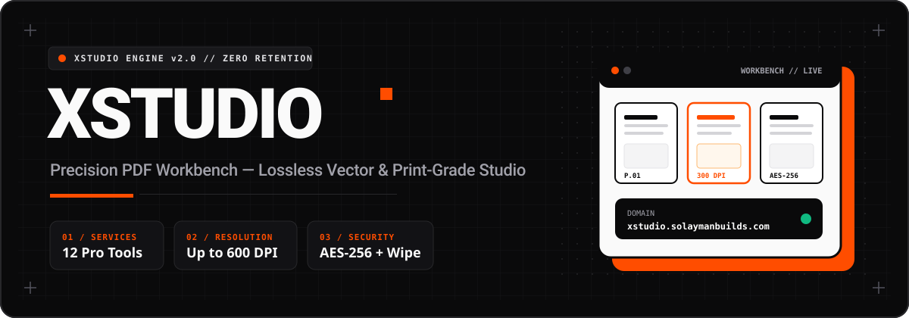
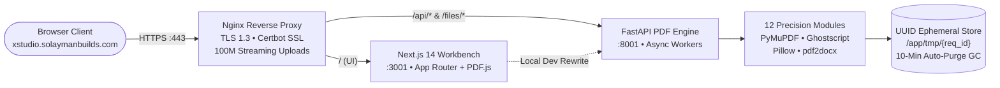

<div align="center">



<br />

[](https://xstudio.solaymanbuilds.com)
[](https://nextjs.org/)
[](https://fastapi.tiangolo.com/)
[](./Makefile)
[-10B981?style=flat-square&labelColor=0A0A0B)](#security--zero-retention-privacy)

**Swiss-Brutalist Precision PDF Studio — Zero Login. Lossless Vector Output. Ephemeral Sandbox.**

[Live Production](https://xstudio.solaymanbuilds.com) · [12 Studio Services](#-the-12-studio-services) · [System Architecture](#-system-architecture) · [Makefile CLI](#-makefile-command-interface) · [VPS Deployment](#-vps-deployment--updates)

</div>

---

```text
┌──────────────────────────────────────────────────────────────────────────────────────────┐
│  XSTUDIO // DESIGN MANIFESTO                                                             │
│  01. ZERO COMPROMISE ON FIDELITY  → Lossless streams, vector paths & up to 600 DPI       │
│  02. ZERO FRICTION WORKBENCH      → Interactive lightboard, live diff & pipeline chain   │
│  03. ZERO DATA RETENTION          → Isolated UUID workspaces auto-purged every 10 mins   │
└──────────────────────────────────────────────────────────────────────────────────────────┘
```

---

## 🏛️ The 12 Studio Services

Every service in **Xstudio v2.0** is engineered around strict output quality guarantees—preserving vector typography, embedded font subsets, clickable hyperlinks, and high-chroma raster streams.

| # | Service | Quality Guarantee | Studio Capabilities |
| :-: | :--- | :--- | :--- |
| `01` | **Merge PDFs** | `LOSSLESS + TOC` | Drag-and-drop sequence, A–Z / reverse sort, automatic clickable PDF Bookmarks (Outline), optional A4 normalization |
| `02` | **Split PDF** | `LOSSLESS VECTOR` | 3 modes: Custom page ranges (`1-3, 4-6`), Fixed `Every N Pages`, or `Burst All Pages` into a clean `.zip` or merged PDF |
| `03` | **Compress PDF** | `4-TIER SMART GS` | Generates **4 tiers at once** (`Lossless`, `300 DPI Print`, `180 DPI Balanced`, `110 DPI Compact`) with smart anti-bloat size guards & live preview |
| `04` | **Organize Pages** | `VISUAL LIGHTBOARD` | Drag-and-drop page cards to reorder, duplicate slides, rotate individual pages, and prune pages in one lossless pass |
| `05` | **Extract Pages** | `LOSSLESS VECTOR` | Two-way synced interactive thumbnail picker + custom order ranges, export as one PDF or individual PDFs |
| `06` | **Delete Pages** | `STREAM PURGE` | Visual crimson page strike-out (`All` / `Odd` / `Even` / `Invert`) with `garbage=3` object purge so file size genuinely drops |
| `07` | **Rotate Pages** | `ZERO RE-ENCODE` | Instant PDF header rotation (`-90°`, `+90°`, `180°`) per-page or batch-filtered (`All`, `Odd`, `Even`, `Landscape`) |
| `08` | **PDF → Images** | `UP TO 600 DPI` | Crisp rasterization to **Lossless PNG**, **95% 4:4:4 JPG**, or **WebP** at `150`, `300`, or `600 DPI` with page range filtering |
| `09` | **Images → PDF** | `300 DPI LANCZOS` | Automatic EXIF orientation fix, `A4` / `US Letter` / `Borderless Fit Image` geometry, alpha-to-white compositing, Lanczos resampling |
| `10` | **PDF → Word** | `LAYOUT ENGINE` | Reconstructs editable `.docx` files preserving tables, multi-column layouts, embedded images, and font weights via `pdf2docx` |
| `11` | **Watermark & `#`** | `VECTOR OVERLAY` | Crisp vector text stamps (`Diagonal 45°`, `Center`, `Header`, `Footer`) with adjustable opacity + automatic `Page X of Y` numbering |
| `12` | **Protect / Unlock** | `AES-256 CRYPTO` | Encrypt PDFs with 256-bit AES passwords and granular print/copy permissions, or decrypt authorized password-locked PDFs |

---

## 🎨 Editorial Studio UX Highlights

- **Zero-Flicker Interactive Lightboard**: Memoized document blobs and `pdf.js` canvas thumbnails let you select, reorder, and rotate pages smoothly without reloading previews.
- **Live Output Inspector**: Toggle directly between **Source** and **Output Preview** right inside the right-hand studio canvas before downloading—including side-by-side inspection across all 4 compression tiers.
- **One-Click Pipeline Chaining**: Finished merging or deleting pages? Click **Continue Pipeline** to pipe your newly generated PDF straight into *Compress*, *Watermark*, or *Protect* with zero re-uploading.
- **Quick-Drop Hub & Keyboard Shortcuts**: Drop files directly onto the home hero to auto-route into the right workbench, search tools with `⌘K`, and trigger processing with `⌘ + Enter`.

---

## 🧩 System Architecture



### Repository Layout

```text
Xstudio/
├── assets/
│   └── xstudio-banner.svg       # Custom Swiss-Brutalist vector header art
├── frontend/
│   ├── app/                     # Next.js 14 App Router (Hub + Studio Workbench)
│   ├── components/              # Sidebar, ToolCard, UploadZone, ToolConfig, PreviewPanel
│   └── lib/                     # Tool registry (12 services), XHR progress API, file handoff
├── backend/
│   ├── main.py                  # FastAPI entrypoint, CORS & /api/health probe
│   ├── routers/process.py       # 100MB validated upload pipeline & error sanitizer
│   ├── tools/                   # 12 high-fidelity PDF modules + shared lossless helpers
│   └── utils/cleanup.py         # Async 10-minute ephemeral garbage collector
├── deploy/
│   ├── nginx/xstudio.conf       # Production Nginx reverse proxy template (100M, streaming)
│   └── vps-setup.sh             # Automated Docker + Nginx + Certbot TLS provisioning
├── docker-compose.dev.yml       # Local hot-reload development stack
├── docker-compose.prod.yml      # Health-checked production container stack
└── Makefile                     # Unified Dev, Prod & VPS automation CLI
```

---

## ⚡ Quick Start (Local Development)

Ensure **Docker** and **Docker Compose** are installed, then launch the full hot-reloading workbench:

```bash
# Start Frontend (:3001) + FastAPI Engine (:8001)
make dev

# View live container logs
make logs

# Tear down local dev containers
make dev-down
```

- **Studio UI**: [http://localhost:3001](http://localhost:3001)
- **Engine Health**: [http://localhost:8001/api/health](http://localhost:8001/api/health)
- **OpenAPI Docs**: [http://localhost:8001/docs](http://localhost:8001/docs)

---

## 🛠️ Makefile Command Interface

All local, production, SSL, and VPS lifecycle operations are standardized in the root [`Makefile`](./Makefile):

| Command | Description |
| :--- | :--- |
| `make help` | Display formatted CLI command overview and active domain/email config |
| `make dev` | Start hot-reload development stack on ports `3001` & `8001` |
| `make dev-down` | Stop local development containers |
| `make prod` | Build and start detached production containers (`docker-compose.prod.yml`) |
| `make prod-down` | Stop production containers |
| `make vps-setup` | **Full VPS setup**: installs Docker, Nginx, UFW & Certbot SSL for `xstudio.solaymanbuilds.com` (`elmouden00den@gmail.com`) |
| `make update` | **Zero-friction update**: runs `git pull`, rebuilds images, restarts containers, prunes old layers & reloads Nginx |
| `make pull` | Pull latest commits from `origin/main` |
| `make restart` | Restart running production containers and reload Nginx |
| `make nginx` | Render and reload `/etc/nginx/sites-available/xstudio.solaymanbuilds.com` |
| `make ssl` | Issue or renew Let's Encrypt HTTPS certificate via Certbot |
| `make status` | Check production container status and `/api/health` endpoint |
| `make logs` | Stream live logs from production containers |
| `make clean` | Prune dangling Docker images and build cache |

---

## 🌐 VPS Deployment & Updates

Pre-configured out of the box for **`xstudio.solaymanbuilds.com`** with Let's Encrypt notifications bound to **`elmouden00den@gmail.com`**.

### 1. DNS Prerequisite
Point an **A Record** for `xstudio.solaymanbuilds.com` to your VPS public IPv4 address.

### 2. First-Time VPS Provisioning
Clone the repository onto your Ubuntu/Debian VPS and run one command:

```bash
git clone git@github.com:solacode-SC/Xstudio.git
cd Xstudio
make vps-setup
```

`make vps-setup` automatically:
1. Installs Docker Engine, Docker Compose, Nginx, Certbot, and UFW (`OpenSSH` + `Nginx Full`).
2. Configures Nginx with `client_max_body_size 100M`, unbuffered `/api/` & `/files/` streaming, and iframe-safe `SAMEORIGIN` headers.
3. Builds and starts `xstudio_backend` (`:8001`) and `xstudio_frontend` (`:3001`) with healthchecks.
4. Provisions Let's Encrypt HTTPS certificates for `xstudio.solaymanbuilds.com` (`elmouden00den@gmail.com`) with automatic HTTP → HTTPS redirection and renewal timers.

### 3. Pulling Updates & Restarting in Production
Whenever new code is pushed to `main`, update and restart the live VPS deployment in a single command:

```bash
make update
```

*(Override defaults anytime via `make vps-setup DOMAIN=custom.domain.com EMAIL=admin@domain.com`.)*

---

## 🔒 Security & Zero-Retention Privacy

- **Isolated Request Namespaces**: Every job executes inside a random UUID v4 directory (`/app/tmp/<uuid>`).
- **10-Minute Automatic Garbage Collection**: `cleanup.py` sweeps `/app/tmp` asynchronously and permanently deletes all source uploads and generated artifacts older than 10 minutes.
- **No Accounts, No Tracking, No Cloud Buckets**: Files never touch third-party object storage or external APIs.

---

<div align="center">

**XSTUDIO v2.0** — *Engineered for precision typography, tactile speed, and pure utility.*

</div>
